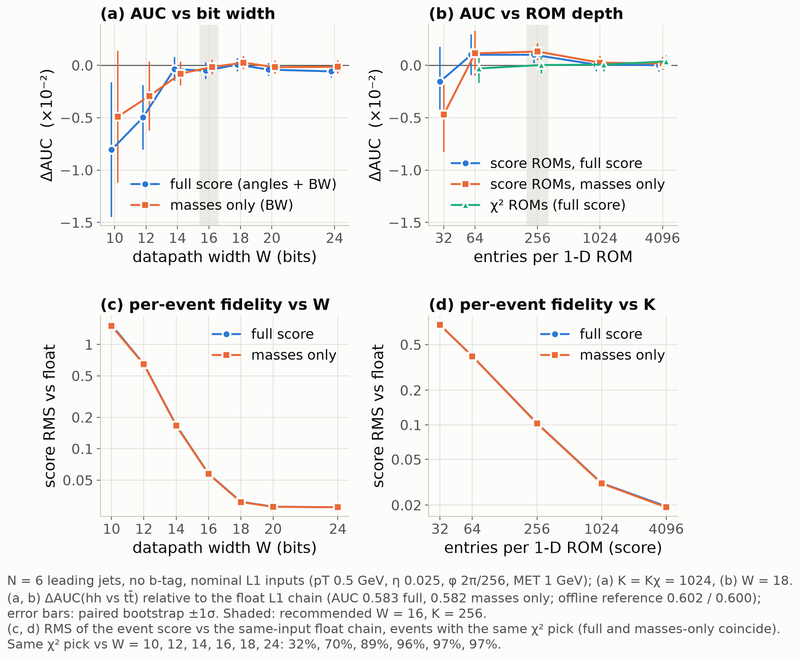
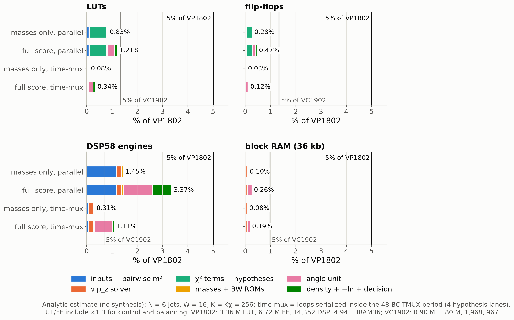
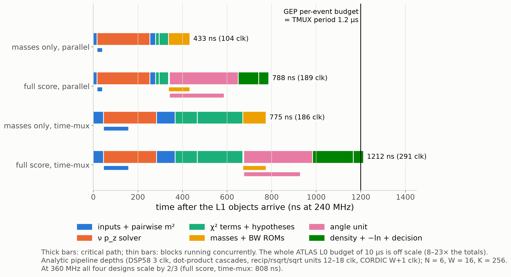

# The "angles + Breit-Wigner" tt̄ score as an ATLAS L0 Global Trigger algorithm on AMD Versal

Feasibility study, 2026-10-08. Everything in this directory was produced on this machine; nothing outside
`study_l1/` was modified.

| file | content |
|---|---|
| `extract.py` | reads the three samples once with the project's own loader (`make_plots.load_sample`, down-type, truth) and caches the L1-relevant objects and the offline reference outputs in `cache/*.npz` |
| `emulate.py` | the bit-true fixed-point emulation of the design, the float references, all scans, the analytic resource/latency model; prints the results table (`python study_l1/emulate.py`, ~2 min, deterministic; `--selftest` for the checks only) |
| `results.json` | every AUC, working point, tail and fidelity metric, the calibration constants, and the per-block resource/latency estimates for all variants |
| `make_figures.py` | `fig_precision.png`, `fig_resources.png`, `fig_latency.png` (+ PDF) from `results.json` |

## 1. Answer in one paragraph

**Yes.** The score maps onto a Versal Premium VP1802 (the FPGA of the ATLAS Global Common Module) with large
margins. The expensive part is the χ² jet assignment, and it becomes cheap with one trick. For massless L1
objects every hypothesis mass is a sum of shared pairwise invariants m²_ij = 2 p_i·p_j. So the 180 jet
assignments × 2 ν solutions need only 35 four-DSP dot products, 47 small χ² ROMs indexed by m² (no square
roots), 360 adders and a comparator tree.

The ten angles need no explicit Lorentz boosts. They come from closed-form, dimensionless expressions:
relativistic aberration, ratios of the same pairwise invariants, and lab-frame components perpendicular to
the boost axes. These are validated against `plotting/angles.py` to 1e-10.

The recommended design costs, of the VP1802:

| design | AUC (hh vs tt̄) | LUT | DSP | latency at 240 MHz |
|---|---|---|---|---|
| masses only (χ² + BW) | 0.5824 | 0.83% | 1.45% | 0.43 µs |
| full score (+ angles) | 0.5830 | 1.21% | 3.36% | 0.79 µs |

Both are far below the 5% budget and the 10 µs L0 latency, and they also fit the 1.2 µs per-event budget
of a GEP node. Fixed point costs nothing in AUC at W ≥ 14 bits and K ≥ 64 ROM entries.

What costs AUC is what L1 does not have:
- no b-tagging: 0.602 → 0.583;
- the leading-6-jet restriction is free, but 4 jets cost another 0.018.

The angles add +0.0004 ± 0.0022, so the masses-only variant is the recommendation.

## 2. What is computed

Score (surprisal; high s = not tt̄), as in `study_salvage/reco_extension.py`:

    s = -ln( f_angles(Ω) - y0 ) + Σ_k ln[(m_k - M_k)² + W_k²],   k = m_W,had, m_t,lep, m_t,had

- **f_angles** is `osde/f_ttbar_reco.npz` truncated to |ĉ|/σ > 10. That leaves 31 complex terms, or 27
  real terms after merging the 4 conjugate pairs (c_k B_k + c_k' B_k' = 2 Re c_k B_k, checked numerically).
- **y0** is 2.5 × min f on the calibration sample.
- **M_k, W_k** are the median and half-IQR of tt̄ on the calibration sample. Calibration uses the first 30k
  events of `run_seed1001` (as `reco_extension.py`), processed by the *same* chain as the test events. In
  firmware these are ROM contents.
- **Test samples:** `run_seed12345` (tt̄, 10k) and `hh_bblvqq/run_seed2001` (20k).
- **Event set:** the offline preselection with χ² ok, i.e. 2440 tt̄ and 1878 hh, the same as the
  reference. Section 5.5 repeats the main numbers for an L1-like event set without the b-tag requirement.

**Reference reproduced exactly.** An independent float implementation of the χ² reconstruction (6 jets,
b-tag slots, both ν solutions) and `plotting/angles.py` gives:

| | AUC, this study | AUC, reference |
|---|---|---|
| angles + BW | 0.6019 | 0.6019 |
| masses | 0.6003 | 0.6003 |
| angles | 0.5182 | 0.5182 |

The events are the same, and the χ² picks the same jets in 100% of them.

## 3. The design

### 3.1 Dataflow (one event at a time; N = 6 leading jets)

```
L1 objects from the GEP lists: 6 jets (pT, η, φ codes), 1 lepton (pT, η, φ), MET (Ex, Ey)
 [0] decode: cos/sin φ and cosh/sinh/sech/tanh η ROMs indexed by the codes; px,py,pz,E = pT x ROM  (4 mul/object)
 [1] pairwise invariants (massless): m²_ij = 2(E_iE_j - p_i·p_j), 15 jet-jet + 6 lepton-jet     (4-DSP cascades)
 [2] ν solver (massless lepton, closed form):  μ = M_W²/2 + pT_l·MET,  κ = μ/pT_l  (1/pT_l from a ROM on the pT code)
       D = sqrt(max(κ² - MET², 0)),  p_z± = κ sinh η_l ± D cosh η_l,  E± = sqrt(MET² + p_z±²)    (3 sqrt units)
     then m²_lν±, m²_νj± (14 dots)
 [3] χ² terms from ROMs indexed by m² (no sqrt):  χ²_W(15 pairs), χ²_th(20 triplets, m²_jjb = Σ of 3 pairs),
       χ²_tl(6 b_lep x 2 ν, m²_lνb = m²_lν + m²_lb + m²_νb);  ν solution chosen per b_lep (6 compares)
     180 hypotheses: χ² = χ²_W(q1q2) + χ²_th(q1q2b_h) + min_ν χ²_tl(b_l)  ->  argmin tree (8 levels)
 [4] mux the chosen m²_W,had, m²_t,had, m²_t,lep -> 3 sqrt -> 3 Breit-Wigner ROMs -> sum   ==> masses-only score
 [5] angle unit on the chosen objects (no 4x4 boosts, see 3.3)
 [6] 25 one-dimensional basis ROMs -> 27 real product terms -> f -> ln unit -> -ln(f - y0) + masses -> threshold
```

The down-type W_had quark is the softer jet of the pair, because truth matching is not available at L1.
This costs −0.0004 ± 0.0002 in AUC. b-tagging is not available at L0, so the χ² runs over all 180
assignments.

### 3.2 Why the combinatorics are cheap

- For massless objects, m²(q1,q2,b) = m²_q1q2 + m²_q1b + m²_q2b and m²(l,ν,b) = m²_lν + m²_lb + m²_νb.
- Every hypothesis mass is therefore a sum of the 35 pairwise invariants (N = 6).
- Each χ² term is a 1-D function of one m², so it is a ROM indexed by m² over a window:
  - [0, 2¹⁶) GeV² for the W, i.e. m < 256 GeV;
  - [0, 2¹⁸) GeV² for the tops, i.e. m < 512 GeV.
  The address is the top bits of the m² word.
- The min over the two ν solutions factorizes per b_lep.
- The 360 χ² evaluations of the offline code (180 assignments × 2 ν) collapse to 47 ROM lookups, 180 × 2
  adds and a 179-node comparator tree. No square roots, no DSPs.

The emulated hardware picks the same assignment as the same-input float chain in **97%** of events at
W = 18, K_χ = 1024. Against the unquantized float χ² it is 95%, and 91% for the recommended W = 16,
K_χ = 256. The flips are among near-degenerate hypotheses and do not move the AUC (section 5).

### 3.3 The ten angles without boosts (all massless objects; checked against `angles.py` to 1e-10)

| angle | hardware formula | units |
|---|---|---|
| Y | ½ [ln(E+p_z) − ln(E−p_z)] of tt̄ | 2 ln units |
| cos Θ | velocity of t_lep boosted into tt̄: u = v − β(γ − g β·v), g = γ²/(γ+1) = E²/(M(E+M)); cos Θ = u_z/\|u\| | M from Σ of the 15 pairwise m²; 1 sqrt, 4 recip, 1 rsqrt |
| cos θ | aberration of the b: cos θ = (βγ − γ c_b)/(γ − βγ c_b), c_b = b̂·ẑ, γ = E_t/m_t, βγ = P_t/m_t | 1 recip |
| φ | atan2(−b̂·ŷ, −b̂·x̂): components ⊥ the top direction are boost invariant (x̂, ŷ: top-frame axes in the lab) | CORDIC |
| cos θ′ | (m²_fb − m²_ob)/(m²_fb + m²_ob), from pairwise invariants already computed | 1 recip |
| φ′ | atan2(d_b(b_y f_x − b_x f_y), −n_b(b_x f_x + b_y f_y) − (b_x² + b_y²)(γ c_f − βγ)), with n_b = βγ − γ c_b and d_b = γ − βγ c_b | CORDIC |

- Unit directions of jets and the lepton (b̂, f̂) are ROMs of the η and φ codes.
- The tilded angles use the same unit on the hadronic top: f = softer W jet, o = harder jet.
- Per top this is 3 rsqrt, 2 recip, 2 CORDIC and about 64 DSPs.
- The derivation is the observation that only the polar angles need the boost, and they follow from
  invariants.

### 3.4 Density and score

- Each kept term is a product of 1-D functions, M = R1(cos θ) R2(cos θ′) e^{−i(m′φ + mφ′)} times
  p_l(cos Θ) h_n(Y), with:
  - R1 = √(2j1+1)/√(4π) d^{j1}_{m′m};
  - R2 = √(2j2+1)/√(4π) d^{j2}_{m0}.
- The kept terms need **25 one-dimensional ROMs**: per top, d-functions in cos θ and cos θ′ plus cos/sin of
  φ and φ′; P2, P4 in cos Θ; h0, h1, h2, h4 in Y.
- The ROMs are uniform in cos (on [−1, 1]), φ/π (periodic) and Y (on [−4, 4)).
- Each of the 27 real terms is Re(c · M_lep · M_had) · p_l h_n. Constants are W-bit mantissas, f is
  carried as f·2¹⁴, and the sum is an adder tree.
- −ln(f − y0) is a normalize + mantissa-ROM ln unit, with the reference's clip floor.
- The three Breit-Wigner factors are ROMs uniform in m, over [0, 512) GeV for m_W,had and [0, 1024) GeV
  for the tops, after 3 sqrt units.

### 3.5 L1 inputs (quantization)

| scheme | jet and lepton pT LSB | η LSB | φ LSB | MET Ex, Ey LSB | code bits pT/η/φ |
|---|---|---|---|---|---|
| fine | 0.25 GeV | 0.0125 | 2π/512 | 0.25 GeV | 13/9/9 |
| **nominal** | **0.5 GeV** | **0.025** | **2π/256** | **1 GeV** | **12/8/8** |
| coarse | 1 GeV | 0.1 | 2π/64 | 2 GeV | 11/6/6 |

- **Typical values:** Run-3 jFEX small-R jet TOBs have 200 MeV/count on 0.1 × 0.1 trigger towers; eFEX
  EM TOBs have 100 MeV/count; jFEX MET Ex/Ey have 200 MeV/count (ATLAS software, `jFexSRJetRoI_v1`,
  `eFexEMRoI_v1`, `jFexMETRoI_v1`).
- **Phase-II:** the GEP builds jets from full-granularity topoclusters, so positions finer than 0.1 are
  expected.
- **Nominal choice:** in between, as suggested in the request.
- **Not available at L1:** jet masses (jets are massless) and b-tags.
- **Leptons:** quantized like jets.

### 3.6 Fixed-point formats and operators (datapath width W; integer bits I include the sign)

| class | I | range | LSB at W = 16 |
|---|---|---|---|
| unit (cos, sin, sech, tanh, unit vectors, β, cos θ) | 2 | ±2 | 6e-5 |
| hyp (cosh η, sinh η) | 4 | ±8 | 2.4e-4 |
| ratio (γ, βγ, boost components) | 5 | ±16 | 4.9e-4 |
| mom (object p, E) / momT (tops, tt̄) | 13 / 14 | ±4 / ±8 TeV | 0.125 / 0.25 GeV |
| m2 (unsigned) / m2s (ν solver) | 22 / 23 | 4.2e6 GeV² | 64 / 128 GeV² |
| mass after sqrt (unsigned) | 11 | 2048 GeV | 0.03 GeV |
| χ² term / sum of 3 (unsigned, saturating) | 9 / 11 | 512 / 2048 | 0.008 / 0.03 |
| basis values, f·2¹⁴ | 2 | ±2 | 6e-5 |
| surprisal terms | 6 | ±32 | 1e-3 |
| azimuth (units of π), Y | 1, 4 | | |

Arithmetic rules:
- Rounding is to nearest, with saturation; `Arith.fx` follows ap_fixed AP_RND/AP_SAT.
- Products of two W-bit operands are exact in the DSP58 (27 × 24); dot products accumulate exactly and are
  rounded once.
- Operands entering a normalizing unit carry a W-bit mantissa (leading-zero count and shift).

Units, emulated bit by bit:

| unit | how it works | precision at W = 18 |
|---|---|---|
| reciprocal | 2¹⁰-entry seed ROM + 1 Newton step | 1.7e-5 relative |
| rsqrt | parity + 9-bit seed ROM + 1 Newton step | 2.5e-5 relative |
| sqrt | x·rsqrt | 2.5e-5 relative |
| ln | exponent + K-entry mantissa ROM | 4.9e-4 at K = 1024 |
| CORDIC atan2 | W − 2 iterations, normalized inputs | 1.0e-4 rad |

The emulation is exact in float64 because every value stays on its grid and products of ≤ 26-bit operands
are exact.

**Self-test** (`--selftest`): run with W = float, exact functions and unquantized inputs, the
hardware-formula code path reproduces the float chain built on `angles.py` event by event:
- same assignment: 100%;
- \|Δm\| < 5e-12 GeV;
- \|Δangle\| < 2e-13;
- \|Δf\|/f < 1e-14.

## 4. Figures



**Figure 1 – AUC and per-event fidelity vs datapath width W and ROM depth K (N = 6, nominal inputs).**
(a, b) The AUC is flat within ±0.001 (≤ 1.6σ, paired bootstrap) for W ≥ 14 and K ≥ 64. (c, d) The
per-event fidelity degrades monotonically as W or K get coarser; the floors at W ≥ 20 are the K = 1024
ROM binning.



**Figure 2 – Resources by block as % of a VP1802, against the 5% budget.** The thin grey line is 5% of a
VC1902. The binding resource is DSPs.



**Figure 3 – Pipeline schedule at 240 MHz.** The ν solver is the longest block on the critical path.
Everything is below the 1.2 µs GEP budget except the full time-multiplexed design (1.21 µs at 240 MHz,
0.81 µs at 360 MHz).

## 5. Physics performance vs precision (AUC hh vs tt̄; ΔAUC with paired-bootstrap σ)

Statistical precision:
- absolute AUCs have ±0.009 (2440 tt̄, 1878 hh);
- paired differences between configurations on the same events are known to ±0.0006–0.003.

### 5.1 From the offline reference to what L1 can do (float, offline event set)

| configuration | AUC full | AUC masses | AUC angles | AUC χ²_min | ΔAUC full vs offline | same jets as offline (tt̄) |
|---|---|---|---|---|---|---|
| offline reference (6 jets, b-tag slots, truth down-type) | 0.602 | 0.600 | 0.518 | 0.601 | – | 100% |
| + softer jet = down-type | 0.601 | 0.600 | 0.515 | 0.601 | −0.0004 ± 0.0002 | 100% |
| + no b-tag in the χ² | 0.583 | 0.582 | 0.513 | 0.579 | −0.0190 ± 0.0055 | 45% |
| + massless objects = **float L1, N = 6** | **0.583** | **0.582** | 0.512 | 0.580 | −0.0186 ± 0.0057 | 40% |
| float L1, N = 5 leading jets | 0.581 | 0.579 | 0.515 | 0.575 | −0.0207 ± 0.0060 | 38% |
| float L1, N = 4 leading jets | 0.565 | 0.564 | 0.508 | 0.561 | −0.0373 ± 0.0077 | 30% |

The b-tag is the only large loss. Without it the χ² agrees with the offline choice in only 45% of tt̄
events.

Restricting to the leading 6 jets is free, because the offline code already does it. N = 5 costs −0.002
(full) / −0.004 (masses); N = 4 costs −0.018.

The χ²_min itself (free in hardware) is almost as good a score: 0.580 vs 0.582.

### 5.2 Input quantization (float arithmetic, exact functions; ΔAUC vs float L1 with the same N)

| N | scheme | AUC full | ΔAUC full | ΔAUC masses | same χ² pick as unquantized |
|---|---|---|---|---|---|
| 6 | fine | 0.583 | −0.0005 ± 0.0004 | −0.0001 ± 0.0003 | 98.1% |
| 6 | nominal | 0.583 | −0.0004 ± 0.0006 | −0.0002 ± 0.0006 | 96.0% |
| 6 | coarse | 0.580 | −0.0036 ± 0.0016 | −0.0034 ± 0.0014 | 84.8% |
| 5 | nominal | 0.580 | −0.0010 ± 0.0007 | −0.0005 ± 0.0006 | 96.1% |
| 4 | nominal | 0.565 | −0.0002 ± 0.0006 | +0.0002 ± 0.0006 | 97.5% |

### 5.3 Datapath width W and ROM depths (N = 6, nominal inputs)

Two references are used:
- ΔAUC is against the float L1 chain (unquantized).
- The fidelity columns are against the float chain with the same quantized inputs: the fraction of
  events with the same χ² pick (tt̄ / hh), and the RMS of the event score for events with the same pick.

For scale, the score has a standard deviation of 2.9 (tt̄) and 3.2 (hh).

| W (K = K_χ = 1024) | AUC full | ΔAUC full | ΔAUC masses | same pick | score RMS |
|---|---|---|---|---|---|
| 10 | 0.574 | −0.0081 ± 0.0064 | −0.0049 ± 0.0063 | 35 / 30% | 1.54 |
| 12 | 0.578 | −0.0050 ± 0.0031 | −0.0029 ± 0.0033 | 70 / 69% | 0.65 |
| 14 | 0.583 | −0.0004 ± 0.0011 | −0.0008 ± 0.0011 | 89 / 89% | 0.17 |
| **16** | 0.583 | −0.0005 ± 0.0008 | −0.0002 ± 0.0007 | 95 / 96% | 0.058 |
| 18 | 0.583 | +0.0001 ± 0.0006 | +0.0003 ± 0.0006 | 97 / 97% | 0.031 |
| 20 | 0.583 | −0.0004 ± 0.0006 | −0.0002 ± 0.0006 | 97 / 97% | 0.028 |
| 24 | 0.583 | −0.0006 ± 0.0006 | −0.0001 ± 0.0006 | 97 / 97% | 0.028 |

| score ROM entries K (W = 18) | ΔAUC full | ΔAUC masses | score RMS |
|---|---|---|---|
| 32 | −0.0016 ± 0.0033 | −0.0047 ± 0.0036 | 0.74 |
| 64 | +0.0010 ± 0.0019 | +0.0011 ± 0.0021 | 0.40 |
| **256** | +0.0010 ± 0.0008 | +0.0013 ± 0.0008 | 0.10 |
| 1024 | +0.0001 ± 0.0006 | +0.0003 ± 0.0006 | 0.031 |
| 4096 | +0.0000 ± 0.0006 | +0.0002 ± 0.0006 | 0.019 |

| χ² ROM entries K_χ (W = 18, K = 1024) | ΔAUC full | ΔAUC masses | same pick |
|---|---|---|---|
| 64 | −0.0003 ± 0.0014 | −0.0001 ± 0.0012 | 80 / 81% |
| **256** | +0.0000 ± 0.0008 | +0.0003 ± 0.0007 | 94 / 93% |
| 1024 | +0.0001 ± 0.0006 | +0.0003 ± 0.0006 | 97 / 97% |
| 4096 | +0.0004 ± 0.0006 | +0.0006 ± 0.0006 | 98 / 97% |

N = 5 behaves the same way (`results.json`, group `W`/`K`/`Kchi`).

**Monotonicity.** The per-event fidelity degrades monotonically as W and K get coarser. The AUC follows
for W ≤ 12 and K = 32, and is flat elsewhere within the paired errors. The +0.001 bumps at K = 64–256
are 0.5–1.6σ.

**Saturations.** At W ≥ 14 the only saturations are about 48 pair masses above 2 TeV and 5 masses above
2048 GeV, out of ~1.4 × 10⁵ pair values. They are harmless: such hypotheses lose anyway.

### 5.4 Recommended configuration, working points and the hh-like tail

The recommended configuration: N = 6, nominal inputs, W = 16, K = K_χ = 256.

| | AUC | ΔAUC vs float L1 | ε_tt̄ at ε_hh = 0.9 / 0.5 / 0.1 |
|---|---|---|---|
| offline reference, full | 0.602 | | 0.810 / 0.354 / 0.068 |
| float L1, full | 0.583 | | 0.846 / 0.375 / 0.067 |
| **recommended, full score** | 0.5830 | −0.0002 ± 0.0009 | 0.836 / 0.382 / 0.068 |
| float L1, masses only | 0.582 | | 0.834 / 0.381 / 0.070 |
| **recommended, masses only** | 0.5824 | +0.0002 ± 0.0008 | 0.827 / 0.380 / 0.070 |

The angle contribution (full − masses, paired) is consistent with zero:

| | full − masses |
|---|---|
| offline | +0.0016 ± 0.0018 |
| float L1 | +0.0008 ± 0.0023 |
| recommended | +0.0004 ± 0.0022 |

**Tail.** The question is whether the hh-like tail is selected the same way. Cuts are set to keep a fixed
fraction of tt̄ and compared with the float L1 chain at its own cut. "Same events" is the fraction of the
float-selected events that the bit-true chain also selects.

| tt̄ kept | hh kept (bit-true / float), full | same events hh / tt̄, full | hh kept, masses only | same events hh / tt̄, masses only |
|---|---|---|---|---|
| 10% | 13.7% / 13.8% | 98% / 98% | 13.8% / 14.1% | 97% / 98% |
| 5% | 7.9% / 7.7% | 97% / 97% | 7.1% / 7.1% | 95% / 96% |
| 1% | 1.9% / 1.9% | 83% / 80% | 2.1% / 2.1% | 80% / 72% |

At 1% only 24 tt̄ and ~36 hh events are selected, so one changed event is 3–4%. The tail survives
quantization: the efficiencies are unchanged and ≥ 95% of the selected events are the same at the 5–10%
level.

Note that the separation is weak at any precision: keeping 50% of hh keeps 38% of tt̄.

### 5.5 L1 event set and a resolution stress test

**L1 event set** (exactly one lepton, ≥ 4 jets, no b-tag requirement; 2830 tt̄, 2133 hh):

| | AUC full | AUC masses |
|---|---|---|
| float L1, N = 6 | 0.5832 | 0.5823 |
| recommended | 0.5831 | 0.5825 |

ΔAUC = −0.0001 ± 0.0009 (full) and +0.0003 ± 0.0008 (masses). Same picture as the offline set.

**Resolution stress test.** L0 objects are worse than offline. As a stress test, extra Gaussian smearing
is applied before quantization: jets 10% in pT, lepton 5%, MET 15 GeV per component.

| | AUC full | AUC masses | ΔAUC |
|---|---|---|---|
| float, smeared inputs | 0.571 | 0.570 | −0.012 ± 0.005 vs unsmeared |
| bit-true recommended, smeared inputs | 0.571 | 0.569 | −0.0006 ± 0.0010 vs smeared float |

Resolution matters about as much as the b-tag loss; precision still does not.

## 6. Resources and latency (analytic, no synthesis)

### 6.1 Assumptions

**Devices** (AMD; per resource, 5% budget in brackets):

| device | LUT | FF | DSP58 | BRAM36 |
|---|---|---|---|---|
| VP1802 (two per ATLAS GCM) | 3,360,896 (168k) | 6,721,792 (336k) | 14,352 (718) | 4,941 (247) |
| VC1902 (smaller comparison) | 899,840 (45k) | 1,799,680 (90k) | 1,968 (98) | 967 (48) |

The VP1802 also has 2,549 URAM; URAM is not needed here.

**Operators:**

| operator | cost | latency |
|---|---|---|
| multiplier, W ≤ 24 (27 × 24 DSP58) | 1 DSP | 3 clk |
| dot product of n terms (DSP cascade) | n DSP | n + 2 clk |
| adder | W LUT + W FF | 1 clk |
| compare-select (value + 8-bit index) | 2W + 8 LUT | 1 clk |
| ROM ≤ 256 entries (LUTRAM) | 1.25 W ⌈K/64⌉ LUT | 1 clk |
| ROM > 256 entries (block RAM, 1K × 18) | 0.5 BRAM36 | 2 clk |
| recip | 2 DSP + 0.5 BRAM | 12 clk |
| rsqrt | 3 DSP + 0.5 BRAM | 15 clk |
| sqrt | 4 DSP + 0.5 BRAM | 18 clk |
| ln | 1 DSP + ROM | 8 clk |
| CORDIC (unrolled) | 3(W+2)(W−2) LUT and FF | W + 1 clk |

**Other assumptions:**
- Each normalizing unit also costs 2W⌈log₂W⌉ LUT for its leading-zero count and shifters.
- LUT and FF are multiplied by 1.3 for control, multiplexers and pipeline balancing.
- Clock: 240 MHz.

**Architecture.** The GEP is time-multiplexed: a node receives a new event every 48 BC = 1.2 µs = 288
clocks.
- **Parallel:** one event in flight, so no inter-event delay lines are needed. Initiation interval =
  latency < 288 clocks.
- **Time-mux:** loops serialized: one object decoder, one 4-DSP pairwise unit, 3 χ² ROMs, 4 hypothesis
  lanes, one shared mass sqrt, one top unit used twice, one complex MAC over the 27 density terms.

### 6.2 Per block: recommended configuration, fully parallel (N = 6, W = 16, K = K_χ = 256)

| block | LUT | FF | DSP | BRAM36 | latency (clk) |
|---|---|---|---|---|---|
| input decode (7 objects: η/φ ROMs, 4 mul each) | 2,912 | 1,165 | 28 | 0 | 4 |
| pairwise m², 15 jet-jet + 6 lepton-jet (4-DSP dots) | 0 | 437 | 84 | 0 | 6 (∥ ν) |
| ν p_z solver (1/pT ROM, 3 sqrt) | 645 | 686 | 28 | 3.5 | 57 |
| ν-jet and ℓν m² (14 dots) | 0 | 291 | 56 | 0 | 6 |
| χ² terms (47 ROM lookups, 32 m² sums, ν choice) | 6,531 | 2,496 | 0 | 0 | 4 |
| 180 hypotheses (360 adds) + argmin tree | 16,796 | 13,073 | 0 | 0 | 10 |
| masses: mux, 3 sqrt, 3 BW ROMs, sum, threshold | 1,123 | 666 | 12 | 1.5 | 23 |
| **masses-only total** | **28,007** | **18,814** | **208** | **5** | **104 = 433 ns** |
| angles: production (Y, cos Θ) | 2,226 | 1,893 | 38 | 3 | 74 |
| angles: top-decay unit × 2 | 7,134 | 7,134 | 128 | 5 | 59 (∥) |
| density: 25 ROMs, 27 product terms, adder tree | 3,162 | 3,328 | 108 | 0 | 22 |
| −ln(f − y0), final sum, threshold | 302 | 156 | 1 | 0 | 11 |
| **full-score total** | **40,830** | **31,325** | **483** | **13** | **189 = 788 ns** |

### 6.3 Variants against the budgets

The percentage columns give LUT / FF / DSP / BRAM. W = 16, K = 256.

| N | score | architecture | LUT | DSP | % of VP1802 | % of VC1902 | latency at 240 MHz | II |
|---|---|---|---|---|---|---|---|---|
| 6 | masses | parallel | 28.0k | 208 | 0.83 / 0.28 / 1.45 / 0.10 | 3.1 / 1.0 / **10.6** / 0.5 | 433 ns | 104 clk |
| 6 | full | parallel | 40.8k | 483 | 1.21 / 0.47 / 3.36 / 0.26 | 4.5 / 1.7 / **24.5** / 1.3 | 788 ns | 189 |
| 6 | masses | time-mux, 4 lanes | 2.8k | 44 | 0.08 / 0.03 / 0.31 / 0.08 | 0.3 / 0.1 / 2.2 / 0.4 | 775 ns | 45 |
| 6 | full | time-mux, 4 lanes | 11.6k | 159 | 0.34 / 0.12 / 1.11 / 0.19 | 1.3 / 0.5 / **8.1** / 1.0 | 1212 ns | 45 |
| 6 | full | time-mux, 12 lanes | 12.7k | 159 | 0.38 / 0.14 / 1.11 / 0.19 | 1.4 / 0.5 / **8.1** / 1.0 | 1096 ns | 27 |
| 5 | masses | parallel | 14.0k | 172 | 0.42 / 0.13 / 1.20 / 0.10 | 1.6 / 0.5 / **8.7** / 0.5 | 425 ns | 102 |
| 5 | full | parallel | 26.9k | 447 | 0.80 / 0.32 / 3.12 / 0.26 | 3.0 / 1.2 / **22.7** / 1.3 | 779 ns | 187 |
| 4 | masses | parallel | 7.5k | 140 | 0.22 / 0.07 / 0.97 / 0.10 | 0.8 / 0.2 / **7.1** / 0.5 | 417 ns | 100 |

Dependence on W and K:
- W (12 → 24) changes LUT and FF by about ×1.6 (full parallel: 30k → 65k LUT at K = 256). DSP count is
  constant, since all W ≤ 24 fit one DSP58.
- K = 1024 moves the ROMs to block RAM: 13 → 52 BRAM36, or 0.26% → 1.05%, and slightly fewer LUTs.

Latency against the budgets:
- The whole ATLAS L0 latency is 10 µs. Every variant uses ≤ 12% of it.
- The GEP per-event budget, equal to the TMUX period, is 1.2 µs. All variants fit except the 4-lane
  time-mux full score at 240 MHz (1.21 µs); with 12 lanes it is 1.10 µs, and at 360 MHz 0.81 µs.
- The upstream GEP algorithms (topoclustering, jet finding) share that 1.2 µs. So the parallel designs
  (0.43 / 0.79 µs) are the realistic ones, and the masses-only one leaves the most room.

### 6.4 Trade-offs

| choice | AUC effect | cost effect |
|---|---|---|
| angles vs masses only | +0.0004 ± 0.0022 (not significant) | +275 DSP (+1.9% of VP1802), +13k LUT, +0.36 µs |
| N = 6 → 5 jets | −0.002 / −0.004 | −14k LUT (180 → 60 hypotheses), −36 DSP |
| N = 6 → 4 jets | −0.018 | −20k LUT, −68 DSP |
| parallel → time-mux | 0 (same arithmetic) | DSP ÷3–5, LUT ÷4–10, latency +0.34–0.42 µs |
| W = 16 → 12 | −0.003 to −0.005 | −25% LUT/FF |
| W = 16 → 18 or 24 | 0 | +15% / +60% LUT/FF |
| K = 256 → 64 | 0 within errors (score RMS ×4) | −14% LUT |
| K = 256 → 32 | −0.005 (masses) | marginal saving |
| K_χ = 256 → 64 | 0 (80% same pick) | small |
| χ²_min alone as the score | −0.002 | drops 3 sqrt + BW ROMs (−12 DSP) |

## 7. Recommendation

**Masses-only χ² + Breit-Wigner score:**
- N = 6 leading jets, no b-tag;
- nominal L1 inputs;
- W = 16-bit datapath;
- K = K_χ = 256-entry LUTRAM ROMs;
- fully parallel, one event per GEP TMUX slot.

| | value |
|---|---|
| AUC | 0.5824, identical to the float L1 chain (+0.0002 ± 0.0008) |
| cost vs the offline 0.600 | −0.018, due to the missing b-tag |
| resources, % of VP1802 | LUT 0.83%, FF 0.28%, DSP 1.45%, BRAM 0.10% |
| latency | 104 clk = 433 ns at 240 MHz |
| same χ² pick as float | 91% of events |
| hh-like tail at 5% tt̄ acceptance | 95% of the same events selected |

If the angular term is wanted (e.g. to keep the parton-level physics of f), the same settings give the
full score:

| | value |
|---|---|
| AUC | 0.5830 |
| resources, % of VP1802 | LUT 1.21%, FF 0.47%, DSP 3.36%, BRAM 0.26% |
| latency | 788 ns |

Both are within 5% of a VP1802 and within 10 µs, and also within the 1.2 µs GEP budget.

For a VC1902-class device:
- Use the time-multiplexed masses-only design: 44 DSP (2.2%), 0.78 µs.
- The full score needs ≥ 159 DSP there (8%), i.e. more sharing of the angle unit than modelled here.

## 8. Validating the estimate (Vitis HLS; hls4ml)

The numbers in section 6 are an analytic operator count. No Vivado or Vitis HLS is available on this
machine. To validate:

1. **Golden model.** Extend `emulate.py` to dump test vectors per event: the input codes, every
   intermediate of section 3.1 (m²_ij, ν, χ² terms, chosen indices, masses, angles, ROM outputs, f) and
   the score. The formats are those of section 3.6.
2. **HLS kernel** (Vitis HLS C++):
   - `ap_fixed<W,I,AP_RND,AP_SAT>` types per signal class;
   - ROMs as `static const` arrays generated from the same Python functions;
   - the reciprocal/rsqrt/ln units as written here (seed ROM + Newton step), or `hls::recip/rsqrt/log`
     followed by re-emulating those;
   - `hls::atan2` (CORDIC) for φ, φ′;
   - the hypothesis loop either `#pragma HLS UNROLL` (parallel) or `PIPELINE II=1` with a 4-way partial
     unroll (time-mux).
3. **C simulation.** It must be bit-exact against the vectors at every intermediate. This also pins down
   rounding and saturation semantics.
4. **C synthesis** for `xcvp1802` (−2 speed grade) at 4.17 ns. Compare the per-function utilization and
   latency with the table in 6.2. Expected agreement: DSP within the HLS packing choices, LUT/FF within
   ±50%, latency within ±30%.
5. **Vivado.** Out-of-context synthesis + place-and-route, for timing closure at 240 (and 360) MHz and
   post-route utilization. Then C/RTL co-simulation with the vectors, and integration in the GEP algorithm
   framework (inputs: the jet, e/μ and MET TOB lists).

**hls4ml.** The score is not a neural network, so hls4ml's model converter is not the entry point. Its
`ap_fixed` profiling/tracing tools and the community's L1 HLS conventions apply directly. It becomes the
natural path if the hand-built density is ever replaced by a small learned model on the same inputs.

## 9. Caveats

1. **L1 objects are modelled as quantized Delphes offline objects:** offline resolution and calibration,
   no pileup. The stress test shows resolution costs about 0.012 AUC while precision still costs nothing.
   Real GEP jets (topoclusters at ⟨μ⟩ ≈ 200) and L0 MET need full simulation.
2. **No b-tagging at L0 is the dominant loss** (−0.019). The b-tag also defines the offline event set used
   for the main tables; the L1-like set gives the same numbers.
3. **The density f was fit on the offline-chain angles** (truth down-type, b-tag slots). At L1 the angles
   use the softer jet and no b-tags. Refitting f to the L1 definitions costs nothing in firmware (the
   coefficients are constants) but was not done. The angular term is not significant at reco level anyway.
4. **The resource and latency numbers are estimates**, not synthesis results (section 8). The 240 MHz
   clock and the unit latencies are assumptions; timing closure is not demonstrated.
5. **Statistics.** Absolute AUCs ±0.009, paired differences ±0.0006–0.003. The ~+0.001 effects at
   K = 64–256 are fluctuations.
6. **Physics value.** At AUC 0.58 the score is a weak tt̄ discriminant: at 50% hh efficiency it keeps 38% of
   tt̄. tt̄ is also not the dominant L0 background. This study answers feasibility, not whether such a
   trigger is worth its rate.

## Sources

- AMD Versal Premium VP1802 resources:
  [fpgadeveloper.com, iW-G81M SOM](https://boards.fpgadeveloper.com/soms/iG-G81M).
- VC1902 resources: [fpgadeveloper.com, VCK190](https://boards.fpgadeveloper.com/boards/VCK190).
- ATLAS Global Trigger: GCM with two XCVP1802; 48 MUX nodes; a full event to one GEP every 48 BC, "latency
  budget for each event processor is 1.2 µs"; Phase-II strategy of serial instead of parallel combination
  loops; L0 10 µs at 1 MHz. Source:
  [V. Filimonov, Terascale 2025](https://indico.desy.de/event/47789/contributions/181581/attachments/96273/132027/Filimonov_Terascale_2025.pdf),
  citing CERN-LHCC-2017-020 and ATL-COM-DAQ-2021-099.
- Earlier VU13P-based GCM: [arXiv:2010.07667](https://arxiv.org/pdf/2010.07667).
- Run-3 TOB energy scales: ATLAS software
  [jFexSRJetRoI_v1](https://atlas-sw-doxygen.web.cern.ch/atlas-sw-doxygen/atlas_main--Doxygen/docs/html/d6/d39/jFexSRJetRoI__v1_8cxx_source.html),
  [jFexMETRoI_v1](https://atlas-sw-doxygen.web.cern.ch/atlas-sw-doxygen/atlas_main--Doxygen/docs/html/db/db3/jFexMETRoI__v1_8cxx_source.html),
  [eFexEMRoI_v1](https://atlas-sw-doxygen.web.cern.ch/atlas-sw-doxygen/atlas_main--Doxygen/docs/html/d6/d65/classxAOD_1_1eFexEMRoI__v1.html).
